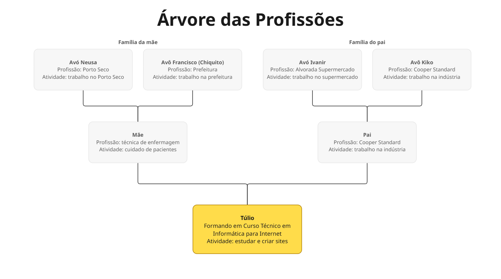

# 🌳 Árvore das Profissões

Projeto em que mapeei as profissões da minha família e mostrei como elas se conectam até chegar na minha trajetória atual: a formação em **Técnico em Informática para Internet**.

<p align="center">
  
</p>

## 📖 Sobre o projeto

A Árvore das Profissões é um diagrama genealógico profissional. Ele reúne:

- **Os avós**, no topo, divididos entre a família da mãe e a família do pai
- **Os pais**, no meio, ligados às duas famílias
- **Eu**, na base, destacado em amarelo, com a minha formação e o que faço hoje

Para cada pessoa, o diagrama mostra a **profissão** e a **atividade** que ela exerce. Assim dá para ver de onde vêm as áreas de trabalho da família e onde eu me encaixo nelas: estudando e criando sites.

## 🎯 O que aprendi

- Mapear competências e áreas de atuação em um diagrama
- Organizar informações em níveis (gerações) de forma clara
- Relacionar a história da minha família com as minhas metas de carreira

## 📁 Estrutura do repositório

```
arvore-das-profissoes/
├── arvore.png    # Imagem final da árvore
└── README.md     # Este arquivo
```

## 🔗 Links

- 🌐 [Portfólio](https://github.com/tulioom/portfolio)
- 👤 [Meu GitHub](https://github.com/tulioom)

## ✍️ Autor

**Túlio Abreu Mendes de Assis**
Técnico em Informática para Internet — Varginha, MG
